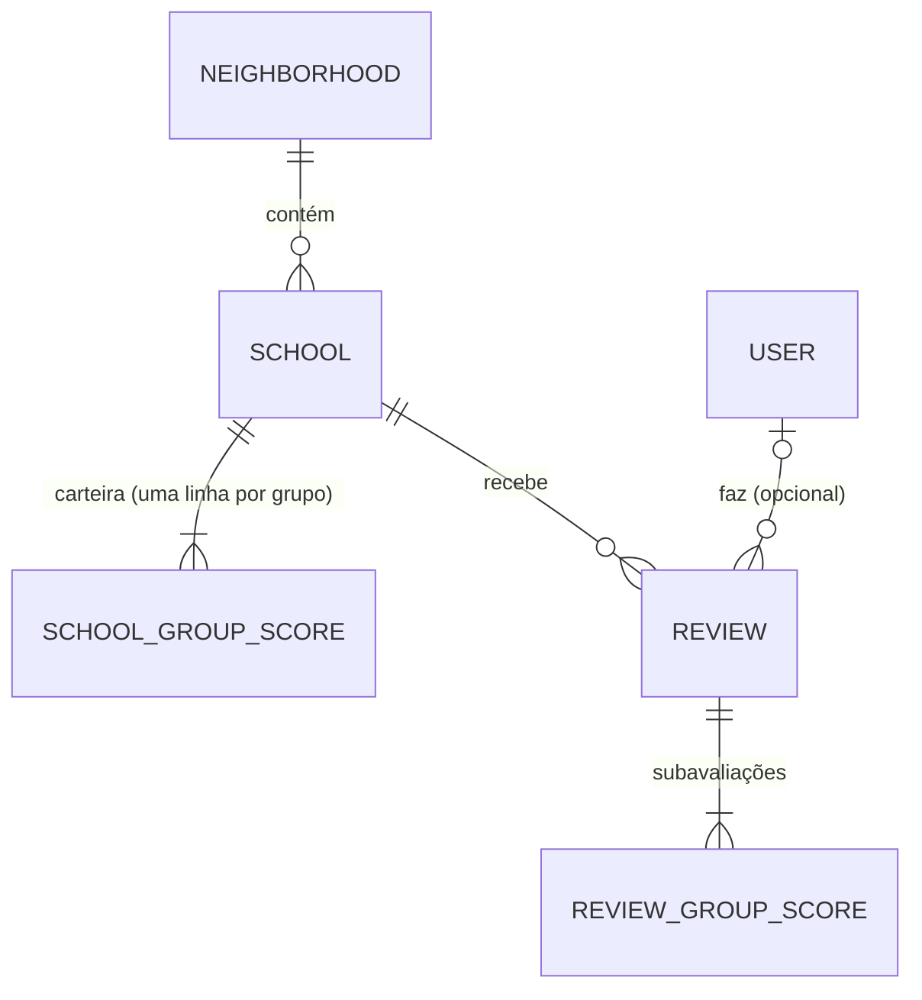

# Portal de Acessibilidade Escolar — Planejamento de Desenvolvimento
*Descrição do projeto · entidades · casos de uso · regras de negócio · método de score · API · ordem de implementação*

Este documento substitui os planejamentos anteriores de backend. Ele reflete as decisões mais recentes: subgrupos abandonados, avaliação por grupo, "carteira" de notas por escola, subavaliações e SQLite.

---

## 1. Descrição do projeto

### Problema
Famílias de pessoas com deficiência (PCD), sobretudo nas etapas iniciais da escola, têm dificuldade de encontrar escolas com a adaptação específica de que precisam. As escolas costumam usar "acessibilidade" de forma genérica, e as soluções existentes tratam o tema como sim/não ou como dado agregado para pesquisadores e gestores. O refinamento da ideia cita que menos de 1% das escolas brasileiras são totalmente acessíveis.

### Solução
Um site web (responsivo, com experiência mobile) onde a família busca escolas **por bairro** e por **grupo de acessibilidade** e vê, para cada escola, o quão bem ela atende cada grupo, segundo as avaliações de outras famílias. A avaliação é um formulário estruturado: o usuário dá uma nota de 1 a 5 para cada grupo que souber avaliar.

### Grupos de acessibilidade (enum)
`visual`, `motora`, `intelectual`, `auditiva`, `psicossocial`.

### Escopo do MVP
- Busca de escolas por bairro e por grupos (OR, priorizando escolas que atendem mais grupos entre os escolhidos).
- Perfil da escola com a nota média e o número de avaliações por grupo (a "carteira").
- Envio de avaliação, **anônimo ou com usuário cadastrado**.
- Listagem das avaliações de uma escola, com as de usuários cadastrados primeiro.
- Cadastro de escolas pela equipe, por planilha CSV.
- Estrutura preparada para o mapa (latitude e longitude opcionais), sem implementar o mapa.

### Fora do MVP
Mapa (última tarefa, se der tempo), selo "confirmado pela escola", fluxo de contestação por escolas, subgrupos de adaptação, comentários em texto livre, publicidade e relatórios comerciais, painel de administração.

### Stack e decisões fechadas

| Tema | Decisão |
|---|---|
| Backend | FastAPI + SQLAlchemy 2.0 |
| Banco | SQLite |
| Camadas | routers → services → repositories → models; **presenters** (schemas Pydantic) fazem a camada de entrada e saída |
| Formulário | Sem entidade/tabela de formulário: o corpo da requisição validado pelo presenter é o formulário |
| Região | Bairro |
| Filtro | OR entre grupos, ordenando primeiro quem atende mais grupos entre os escolhidos |
| Avaliação | Uma nota de 1 a 5 por grupo; máximo da escola é 5 |
| Usuários | Qualquer pessoa pode criar conta; avaliação anônima também existe; todas contam igual na média |
| Prioridade de usuários | Só de ordenação na listagem de avaliações da escola |
| Cadastro de escolas | Equipe, por CSV com script de importação |
| Mapa | Fica para o fim; só reservar latitude e longitude |

---

## 2. Entidades

### 2.1 Diagrama



### 2.2 Tabelas

| Entidade | Campos | Observações |
|---|---|---|
| `Neighborhood` | id, name, municipality | Único em (name, municipality), porque nomes de bairro se repetem entre cidades |
| `School` | id, name, name_normalized, neighborhood_id, address (opc.), latitude (opc.), longitude (opc.), is_active, created_at | Único em (name_normalized, neighborhood_id). Latitude e longitude ficam nulas até a fase do mapa |
| `SchoolGroupScore` (carteira) | school_id, group, has_adaptation, review_count, score_sum | PK (school_id, group). Cinco linhas por escola, criadas na importação. Ver seção 5 |
| `User` | id, email (único), password_hash, created_at | E-mail é dado pessoal: nunca devolver em resposta pública |
| `Review` | id, school_id, user_id (nulo), is_hidden, created_at | Um envio de avaliação. `user_id` nulo = anônima |
| `ReviewGroupScore` (subavaliação) | review_id, group, score | PK (review_id, group). `score` de 1 a 5 |

**Pendência:** `has_adaptation` pressupõe que o cadastro-semente continua registrando se a escola possui o grupo. Se não for assim, a coluna sai e o filtro passa a usar `review_count > 0` (ver seção 11).

### 2.3 Modelos em SQLAlchemy 2.0

```python
import enum

class Grupo(str, enum.Enum):
    VISUAL = "visual"
    MOTORA = "motora"
    INTELECTUAL = "intelectual"
    AUDITIVA = "auditiva"
    PSICOSSOCIAL = "psicossocial"

NOTA_MIN, NOTA_MAX = 1, 5
```

```python
from datetime import datetime
from sqlalchemy import (CheckConstraint, Enum, ForeignKey, Index, String,
                        UniqueConstraint, func, text)
from sqlalchemy.orm import DeclarativeBase, Mapped, mapped_column, relationship

GrupoCol = Enum(Grupo, native_enum=False, length=20,
                values_callable=lambda e: [m.value for m in e])  # guarda "visual", não "VISUAL"

class Base(DeclarativeBase): ...

class Neighborhood(Base):
    __tablename__ = "neighborhoods"
    id: Mapped[int] = mapped_column(primary_key=True)
    name: Mapped[str] = mapped_column(String(120))
    municipality: Mapped[str] = mapped_column(String(120))
    __table_args__ = (UniqueConstraint("name", "municipality"),)

class School(Base):
    __tablename__ = "schools"
    id: Mapped[int] = mapped_column(primary_key=True)
    name: Mapped[str] = mapped_column(String(200))
    name_normalized: Mapped[str] = mapped_column(String(200))       # minúsculas, sem acento
    neighborhood_id: Mapped[int] = mapped_column(ForeignKey("neighborhoods.id"), index=True)
    address: Mapped[str | None] = mapped_column(String(300))
    latitude: Mapped[float | None]                                  # reservado para o mapa
    longitude: Mapped[float | None]                                 # reservado para o mapa
    is_active: Mapped[bool] = mapped_column(default=True)
    created_at: Mapped[datetime] = mapped_column(server_default=func.now())

    scores: Mapped[list["SchoolGroupScore"]] = relationship(back_populates="school")
    __table_args__ = (UniqueConstraint("name_normalized", "neighborhood_id"),)

class SchoolGroupScore(Base):
    __tablename__ = "school_group_scores"
    school_id: Mapped[int] = mapped_column(ForeignKey("schools.id"), primary_key=True)
    group: Mapped[Grupo] = mapped_column(GrupoCol, primary_key=True)
    has_adaptation: Mapped[bool] = mapped_column(default=False)
    review_count: Mapped[int] = mapped_column(default=0)
    score_sum: Mapped[int] = mapped_column(default=0)               # inteiro: notas são inteiras

    school: Mapped[School] = relationship(back_populates="scores")
    __table_args__ = (
        CheckConstraint(
            f"review_count >= 0 AND score_sum >= review_count * {NOTA_MIN} "
            f"AND score_sum <= review_count * {NOTA_MAX}",
            name="ck_wallet_bounds"),
        Index("ix_wallet_group_school", "group", "school_id"),
    )

class User(Base):
    __tablename__ = "users"
    id: Mapped[int] = mapped_column(primary_key=True)
    email: Mapped[str] = mapped_column(String(254), unique=True)
    password_hash: Mapped[str] = mapped_column(String(255))
    created_at: Mapped[datetime] = mapped_column(server_default=func.now())

class Review(Base):
    __tablename__ = "reviews"
    id: Mapped[int] = mapped_column(primary_key=True)
    school_id: Mapped[int] = mapped_column(ForeignKey("schools.id"), index=True)
    user_id: Mapped[int | None] = mapped_column(ForeignKey("users.id", ondelete="SET NULL"))
    is_hidden: Mapped[bool] = mapped_column(default=False)
    created_at: Mapped[datetime] = mapped_column(server_default=func.now())

    scores: Mapped[list["ReviewGroupScore"]] = relationship(
        back_populates="review", cascade="all, delete-orphan")
    __table_args__ = (
        Index("uq_review_user_school", "user_id", "school_id", unique=True,
              sqlite_where=text("user_id IS NOT NULL")),             # 1 avaliação por usuário e escola
        Index("ix_reviews_school_created", "school_id", "created_at"),
    )

class ReviewGroupScore(Base):
    __tablename__ = "review_group_scores"
    review_id: Mapped[int] = mapped_column(ForeignKey("reviews.id"), primary_key=True)
    group: Mapped[Grupo] = mapped_column(GrupoCol, primary_key=True)
    score: Mapped[int]
    review: Mapped[Review] = relationship(back_populates="scores")
    __table_args__ = (CheckConstraint(f"score BETWEEN {NOTA_MIN} AND {NOTA_MAX}",
                                      name="ck_score_range"),)
```

Observação: `group` é palavra reservada do SQL. O SQLAlchemy cita o nome sozinho, mas em SQL escrito à mão use aspas (`"group"`).

---

## 3. Casos de uso

**Atores:** *Visitante* (qualquer pessoa, sem conta), *Usuário* (visitante com conta), *Equipe* (quem cadastra escolas e modera, por script).

### UC01 — Buscar escolas por bairro e grupos
- **Ator:** Visitante ou Usuário.
- **Fluxo:** escolhe um bairro e, opcionalmente, um ou mais grupos e um texto de nome → o sistema devolve as escolas do bairro que possuem pelo menos um dos grupos escolhidos.
- **Regras:** ordem por quantidade de grupos atendidos entre os escolhidos (decrescente), depois por nota de ranking (seção 5.4), depois por id. Sem grupos escolhidos, lista todas as escolas ativas do bairro. Paginação por `limit/offset`.

### UC02 — Ver o perfil da escola
- **Ator:** Visitante ou Usuário.
- **Fluxo:** abre uma escola → o sistema mostra dados básicos e, por grupo, se possui adaptação, a nota média e o número de avaliações.
- **Regra:** a média só aparece quando `review_count >= MIN_REVIEWS_TO_DISPLAY`; abaixo disso devolve `null` com a contagem.

### UC03 — Listar avaliações de uma escola
- **Ator:** Visitante ou Usuário.
- **Fluxo:** abre a lista de avaliações → o sistema devolve cada avaliação com suas notas por grupo e a data.
- **Regras:** avaliações de usuários cadastrados primeiro, depois as anônimas, e dentro de cada bloco as mais recentes; avaliações ocultas não aparecem; nunca expõe `user_id` nem e-mail.

### UC04 — Avaliar uma escola
- **Ator:** Visitante (anônimo) ou Usuário.
- **Fluxo:** o front envia notas de 1 a 5 para um ou mais grupos → o presenter valida → o sistema cria a avaliação, as subavaliações e atualiza a carteira, tudo numa transação → devolve a avaliação criada.
- **Regras:** de 1 a 5 grupos, sem repetição, notas inteiras de 1 a 5; um usuário cadastrado só avalia a mesma escola uma vez (a segunda tentativa retorna conflito; alterar é o UC07); anônimos não têm essa trava.
- **Erros:** escola inexistente ou inativa (404), payload inválido (422), usuário já avaliou (409).

### UC05 — Criar conta
- **Ator:** Visitante.
- **Fluxo:** informa e-mail e senha → o sistema valida, guarda o hash e cria o usuário.
- **Regras:** e-mail único; senha com regra mínima (ex.: 8 ou mais caracteres); nunca guardar senha em texto puro.

### UC06 — Entrar (login)
- **Ator:** Visitante com conta.
- **Fluxo:** envia e-mail e senha → recebe um token JWT.
- **Regra:** o token é opcional no UC04; com token, a avaliação fica ligada ao usuário.

### UC07 — Alterar ou remover a própria avaliação *(opcional no MVP)*
- **Ator:** Usuário.
- **Fluxo:** altera as notas ou remove a avaliação → o sistema aplica a diferença na carteira (seção 5.3).
- **Observação:** só entra se você quiser; o método de score já está preparado.

### UC08 — Ocultar ou restaurar avaliação *(Equipe, por script no MVP)*
- **Fluxo:** marca `is_hidden` e desfaz ou refaz o efeito na carteira (seção 5.3).

### UC09 — Importar escolas por CSV *(Equipe)*
- **Fluxo:** executa o script com a planilha → o sistema cria bairros e escolas, cria as 5 linhas da carteira de cada escola nova e marca os grupos presentes.
- **Regras:** idempotente (rodar de novo não duplica); linhas inválidas vão para um relatório de erros sem derrubar o restante.

---

## 4. Regras de negócio

| Id | Regra |
|---|---|
| RN01 | Nota por grupo é inteira, de 1 a 5 (validada no presenter e por `CHECK` no banco) |
| RN02 | A nota de uma escola em um grupo é a média das notas recebidas; **nunca passa de 5 nem fica abaixo de 1** |
| RN03 | A nota pode subir **e descer** conforme chegam, mudam ou saem avaliações |
| RN04 | Média só é exibida com `review_count >= MIN_REVIEWS_TO_DISPLAY` (valor a definir) |
| RN05 | Avaliações anônimas e de usuários contam igualmente na média |
| RN06 | Na listagem de avaliações, as de usuários cadastrados vêm primeiro |
| RN07 | Usuário cadastrado avalia uma escola uma única vez; para mudar, altera a avaliação existente |
| RN08 | Grupos pertencem ao enum fechado; adicionar um grupo exige mudança de código e linhas novas na carteira |
| RN09 | Dados pessoais (e-mail, `user_id`) nunca saem em respostas públicas |
| RN10 | Avaliações ocultas não entram na listagem nem na carteira |
| RN11 | Região do filtro é o bairro |

---

## 5. Método de score (subir e descer, com teto de 5)

### 5.1 O que você precisa saber sobre o método
Guardamos **soma e contagem**, e a nota é `score_sum / review_count`. A soma só cresce quando entram avaliações, mas a **média pode cair**: com soma 40 e contagem 10 (média 4,0), chega uma nota 1, e a soma vira 41 com contagem 11 (média 3,73). A média também **não ultrapassa 5**, porque é a média de números que valem no máximo 5. O teto é garantido por três camadas: validação no presenter, `CHECK` em `review_group_scores` e `CHECK` na carteira (a soma precisa ficar entre `count * 1` e `count * 5`).

### 5.2 Uma função única para qualquer variação

Toda mudança passa por uma função que aplica **diferenças** (podem ser negativas) com `UPDATE` feito no SQL, nunca "lê, calcula em Python e grava" (esse jeito perde atualizações quando dois envios chegam juntos).

```python
def apply_score_delta(db, school_id: int, group: Grupo, *, d_count: int, d_sum: int) -> None:
    result = db.execute(
        update(SchoolGroupScore)
        .where(SchoolGroupScore.school_id == school_id,
               SchoolGroupScore.group == group)
        .values(review_count=SchoolGroupScore.review_count + d_count,
                score_sum=SchoolGroupScore.score_sum + d_sum)
    )
    if result.rowcount != 1:
        raise CarteiraNaoEncontrada(school_id, group)
    # Se o resultado violar ck_wallet_bounds, o banco levanta IntegrityError
    # e a transação inteira é revertida: estado impossível não é gravado.
```

### 5.3 As três operações

| Operação | `d_count` | `d_sum` |
|---|---|---|
| Nova avaliação (nota `n`) | +1 | +n |
| Alterar nota de `old` para `new` | 0 | new − old |
| Remover ou ocultar (nota `n`) | −1 | −n |
| Restaurar (nota `n`) | +1 | +n |

```python
def create_review(db, school_id, user_id, scores):          # UC04
    review = Review(school_id=school_id, user_id=user_id,
                    scores=[ReviewGroupScore(group=s.group, score=s.score) for s in scores])
    db.add(review)
    for s in scores:
        apply_score_delta(db, school_id, s.group, d_count=+1, d_sum=+s.score)
    db.commit()                                              # tudo ou nada

def change_review(db, review, new_scores):                   # UC07
    old = {s.group: s.score for s in review.scores}
    new = {s.group: s.score for s in new_scores}
    for g in old.keys() | new.keys():
        if g in old and g in new:
            apply_score_delta(db, review.school_id, g, d_count=0, d_sum=new[g] - old[g])
        elif g in new:
            apply_score_delta(db, review.school_id, g, d_count=+1, d_sum=new[g])
        else:
            apply_score_delta(db, review.school_id, g, d_count=-1, d_sum=-old[g])
    # ...atualiza as linhas de review_group_scores para refletir new...
    db.commit()

def hide_review(db, review):                                 # UC08
    if review.is_hidden:
        return
    for s in review.scores:
        apply_score_delta(db, review.school_id, s.group, d_count=-1, d_sum=-s.score)
    review.is_hidden = True
    db.commit()
```

### 5.4 Nota de leitura e nota de ranking

- **Nota exibida:** média simples, `score_sum / review_count`, com limite de segurança `min(5, max(1, x))` e `null` se `review_count < MIN_REVIEWS_TO_DISPLAY`.
- **Nota de ranking (recomendada):** média suavizada, que evita que uma escola com uma única nota 5 passe na frente de outra com 50 avaliações e média 4,8.

```
ranking = (C * M + score_sum) / (C + review_count)
```

`M` é a nota "neutra" de partida (sugestão: 3,0) e `C` é o peso dessa nota, equivalente a `C` avaliações fictícias (sugestão: 5). Os valores são iniciais e ajustáveis em configuração; `C = 0` desliga a suavização. Como `M` está entre 1 e 5, o ranking também fica entre 1 e 5. A nota exibida continua sendo a média real.

Não recomendo, por enquanto, dar mais peso a avaliações recentes: a análise de "antes e depois" de um período depende de médias sem ponderação por data.

### 5.5 Ferramenta de reparo

```python
def recalculate_school_scores(db, school_id: int) -> None:
    """Refaz count e sum de uma escola a partir das subavaliações visíveis."""
```

Use em testes (para conferir a carteira) e para corrigir qualquer divergência. Deve ser a única função que escreve valores absolutos na carteira.

---

## 6. API

| Método | Rota | Descrição | Auth |
|---|---|---|---|
| POST | `/auth/register` | Cria conta | — |
| POST | `/auth/login` | Retorna token JWT | — |
| GET | `/neighborhoods` | Lista bairros (para o filtro) | — |
| GET | `/schools` | Busca com filtros: `neighborhood_id`, `groups`, `q`, `limit`, `offset` | — |
| GET | `/schools/{id}` | Perfil com carteira | — |
| GET | `/schools/{id}/reviews` | Avaliações da escola, usuários primeiro | — |
| POST | `/schools/{id}/reviews` | Cria avaliação | Opcional |
| PUT | `/schools/{id}/reviews/me` | Altera a própria avaliação *(UC07, opcional)* | Obrigatória |
| DELETE | `/schools/{id}/reviews/me` | Remove a própria avaliação *(UC07, opcional)* | Obrigatória |

### Exemplos

**Criar avaliação**
```http
POST /schools/12/reviews
Authorization: Bearer <token>   (opcional)
```
```json
{
  "scores": [
    { "group": "visual", "score": 4 },
    { "group": "motora", "score": 2 },
    { "group": "auditiva", "score": 3 }
  ]
}
```
Resposta `201`:
```json
{
  "id": 87,
  "school_id": 12,
  "created_at": "2026-10-17T14:32:10Z",
  "from_registered_user": true,
  "scores": [
    { "group": "visual", "score": 4 },
    { "group": "motora", "score": 2 },
    { "group": "auditiva", "score": 3 }
  ]
}
```

**Perfil da escola** (`GET /schools/12`)
```json
{
  "id": 12,
  "name": "Escola Exemplo A",
  "neighborhood": { "id": 3, "name": "Boa Viagem", "municipality": "Recife" },
  "address": null,
  "scores": [
    { "group": "visual", "has_adaptation": true, "average": 3.8, "review_count": 21 },
    { "group": "motora", "has_adaptation": true, "average": null, "review_count": 2 },
    { "group": "intelectual", "has_adaptation": false, "average": null, "review_count": 0 },
    { "group": "auditiva", "has_adaptation": true, "average": 4.2, "review_count": 14 },
    { "group": "psicossocial", "has_adaptation": false, "average": null, "review_count": 0 }
  ]
}
```

**Busca** (`GET /schools?neighborhood_id=3&groups=visual,auditiva`)
```json
{
  "items": [
    { "id": 12, "name": "Escola Exemplo A", "matched_groups": ["visual", "auditiva"], "ranking_score": 3.9 },
    { "id": 31, "name": "Escola Exemplo C", "matched_groups": ["visual"], "ranking_score": 4.4 }
  ],
  "limit": 20,
  "offset": 0
}
```
A Escola A aparece antes porque atende os dois grupos escolhidos, mesmo com `ranking_score` menor que a C.

**Criar conta e login**
```json
{ "email": "pessoa@exemplo.com", "password": "********" }
```
Login devolve `{ "access_token": "...", "token_type": "bearer" }`.

### Consulta de busca (referência)

Como a carteira tem uma linha por escola e grupo, tanto a contagem de grupos atendidos quanto a nota de ranking saem de um único join, sem risco de contar em dobro.

```sql
SELECT s.id, s.name,
       COUNT(*) AS matched,
       AVG((:c * :m + g.score_sum) * 1.0 / (:c + g.review_count)) AS ranking
FROM schools s
JOIN school_group_scores g
  ON g.school_id = s.id
 AND g."group" IN (:g1, :g2)
 AND g.has_adaptation = 1
WHERE s.neighborhood_id = :bairro AND s.is_active = 1
GROUP BY s.id
ORDER BY matched DESC, ranking DESC, s.id
LIMIT :limit OFFSET :offset;
```
Se `c = 0`, troque a expressão por `g.score_sum * 1.0 / NULLIF(g.review_count, 0)` e use `NULLS LAST` (SQLite 3.30 ou superior).

### Listagem de avaliações (referência)
```sql
SELECT r.id, r.created_at, (r.user_id IS NOT NULL) AS from_registered_user
FROM reviews r
WHERE r.school_id = :school AND r.is_hidden = 0
ORDER BY (r.user_id IS NULL) ASC, r.created_at DESC, r.id DESC
LIMIT :limit OFFSET :offset;
```
Carregue as subavaliações com `selectinload(Review.scores)` para evitar N+1.

---

## 7. Importação de escolas (CSV)

```
nome,bairro,municipio,endereco,latitude,longitude,grupos
Escola Exemplo A,Boa Viagem,Recife,Rua X 100,,,visual|auditiva
Escola Exemplo B,Várzea,Recife,,,,motora|intelectual
```

`python -m app.scripts.import_schools escolas.csv`

- Cria bairros e escolas ainda inexistentes; identifica a escola por (nome normalizado, bairro) e atualiza os campos.
- Cria as 5 linhas da carteira de cada escola nova (zeradas) e marca `has_adaptation` nos grupos listados em `grupos` (valores do enum, separados por `|`).
- Rejeita valores de grupo fora do enum com mensagem clara e gera relatório de erros.
- Latitude e longitude opcionais, sem validação além do intervalo.
- Por que CSV e não migration: migration versiona estrutura; a lista de escolas vai mudar várias vezes e precisa poder ser reaplicada sem duplicar.

---

## 8. Estrutura do projeto

```
app/
  main.py
  core/          config.py, security.py, rate_limit.py
  db/            base.py, session.py
  models/        enums.py, school.py, review.py, user.py
  presenters/    school.py, review.py, auth.py      # schemas Pydantic de entrada e saída
  repositories/  school_repo.py, review_repo.py, score_repo.py
  services/      search_service.py, review_service.py, score_service.py, auth_service.py
  routers/       schools.py, reviews.py, neighborhoods.py, auth.py
  scripts/       import_schools.py
alembic/
tests/
```

Presenters validam entrada (grupo no enum, nota de 1 a 5, sem repetição, de 1 a 5 itens) e montam a saída (sem `user_id`, sem e-mail, `average` nulo abaixo do mínimo).

### Configuração do SQLite
- `PRAGMA foreign_keys=ON` em toda conexão (no SQLite ele vem desligado).
- `PRAGMA journal_mode=WAL` e `busy_timeout` para leitura e escrita concorrentes; só há um escritor por vez, então mantenha transações curtas.
- SQLAlchemy síncrono é a recomendação para este MVP, com `check_same_thread=False`.
- Variáveis de ambiente: `DATABASE_URL`, `SECRET_KEY`, `MIN_REVIEWS_TO_DISPLAY`, `RANKING_PRIOR_MEAN` (M), `RANKING_PRIOR_WEIGHT` (C), `CORS_ORIGINS`.

---

## 9. Segurança e privacidade

- Hash de senha com Argon2 ou bcrypt; JWT com expiração; segredo em variável de ambiente.
- Limite de taxa nas rotas de escrita (principalmente `POST /reviews` anônimo e login). Como anônimos contam igual na média, a prioridade de usuários na listagem **não** protege a média contra spam.
- CORS restrito ao domínio do frontend.
- E-mail é dado pessoal: política de privacidade, finalidade clara, nunca em respostas públicas. A exclusão de conta usa `ON DELETE SET NULL` em `reviews.user_id`; ao excluir, a avaliação vira anônima e a carteira não muda.
- Termo de uso com a isenção de responsabilidade por informações incorretas.

---

## 10. Testes essenciais

1. **Carteira:** criar avaliação sobe a contagem e a soma só dos grupos enviados.
2. **Nota cai:** após uma nota 5 e uma nota 1, a média é 3 (e não 5).
3. **Teto e piso:** impossível gravar nota fora de 1 a 5; um decremento duplo aciona o `CHECK` e reverte a transação.
4. **Alterar:** mudar nota de 2 para 5 soma +3 na soma e mantém a contagem.
5. **Ocultar e restaurar:** a carteira volta ao valor original depois do ciclo.
6. **Reparo:** `recalculate_school_scores` produz os mesmos valores que as operações incrementais.
7. **Atomicidade:** falha no meio da criação não deixa avaliação sem carteira atualizada.
8. **Duplicidade:** usuário avalia a mesma escola duas vezes → 409; anônimo pode repetir.
9. **Filtro OR:** escola com os dois grupos aparece antes de escola com um, mesmo com ranking menor.
10. **Mínimo de avaliações:** abaixo do mínimo, `average` é `null`.
11. **Listagem:** avaliações de usuário vêm primeiro; ocultas não aparecem; resposta não contém `user_id`.
12. **Importação:** rodar duas vezes não duplica; grupo inválido gera erro no relatório.

---

## 11. Decisões pendentes

1. **Presença da adaptação** (`has_adaptation`): o cadastro-semente continua registrando se a escola possui cada grupo? Se não, retire a coluna e use `review_count > 0` no filtro (escolas sem avaliações não apareceriam na busca por grupo).
2. **`MIN_REVIEWS_TO_DISPLAY`**: valor mínimo de avaliações para exibir a média.
3. **Parâmetros do ranking** (`M` e `C`) ou desligar a suavização.
4. **Alterar e remover avaliação (UC07)**: entra no MVP ou fica para depois.
5. **Todos os cinco grupos obrigatórios no formulário**, ou ao menos um (o padrão deste documento).
6. **Origem das coordenadas** para a fase do mapa.

---

## 12. Ordem de implementação

| Etapa | Entrega |
|---|---|
| 0. Preparação | Repositório, ambiente, FastAPI mínimo, SQLAlchemy com SQLite e PRAGMAs, Alembic, pytest |
| 1. Dados | Enum `Grupo`, models, migration inicial, constraints |
| 2. Importação | Script de CSV (UC09) com carteira inicial e relatório de erros |
| 3. Leitura | `/neighborhoods`, `/schools` com filtro e ordenação, `/schools/{id}` |
| 4. Contas | Cadastro, login e token opcional nas rotas de avaliação |
| 5. Avaliação | `apply_score_delta`, `create_review`, testes 1 a 3, 7 e 8 |
| 6. Listagem | `/schools/{id}/reviews` com usuários primeiro |
| 7. Qualidade | Limite de taxa, CORS, termo de uso, `EXPLAIN QUERY PLAN`, testes restantes |
| 8. Extras | UC07, UC08, `recalculate_school_scores` na rotina |
| 9. Mapa (se der tempo) | Coordenadas, endpoint por área visível, integração no frontend |
